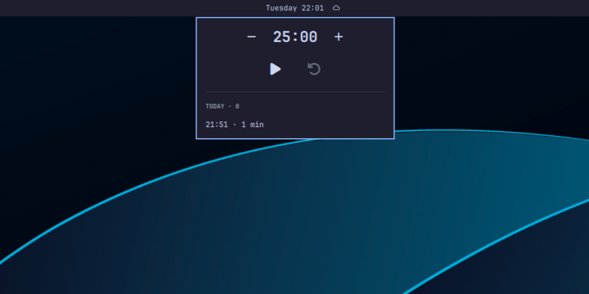

# Pomodoro (`io.github.nejcm.pomodoro`)

A [Pomodoro timer](https://en.wikipedia.org/wiki/Pomodoro_Technique) that lives
in your Omarchy bar, not in a separate app or browser tab. An hourglass glyph
sits idle in the bar until you click it to start a session; while running, the
glyph is replaced by a live `mm:ss` countdown (dimmed while paused) so
remaining time is visible at a glance without opening anything. Click again to
open the timer screen. Its header puts the Timer/Pomodoro tabs on the left and
the settings and history icon buttons on the right, all on one line. History
and settings replace the tabs with a back button at the same left edge.

It's built to disappear when you're not using it: no separate process, no
tray icon, no window to manage — just a widget in a bar you already look at.

Listed on [Omarchy Plugins](https://omarchyplugins.com/plugin.html?id=io.github.nejcm.pomodoro).



## Requirements

- Omarchy with the Quattro shell (`omarchy-shell`) — this is a `bar-widget`
  plugin and uses the shell's `qs.Ui` / `qs.Commons` modules.
- A Nerd Font as the bar font, for the hourglass, coffee, play, pause, reset,
  plus, minus, settings, history, skip, and back glyphs. Omarchy's default
  (JetBrainsMono Nerd Font) covers all eleven; a bar configured with a non-Nerd
  font renders them as tofu.
- `notify-send` (`libnotify`) for the completion notification, which ships with
  Omarchy. Absent, the notification is skipped silently; nothing else breaks.

No other dependencies: the shipped plugin is four QML files and `Model.js`.
It runs inside the existing shell process rather than spawning anything of its
own beyond `mkdir -p` for its state directory and `notify-send` on completion.

## Install

```bash
omarchy plugin add https://github.com/nejcm/omarchy-pomodoro.git --enable
```

This is the command the [marketplace listing](https://omarchyplugins.com/plugin.html?id=io.github.nejcm.pomodoro)
itself gives you. It clones the repo, validates it locally, and only then
installs and enables the plugin — review the source first if you haven't
already; it's third-party, unsandboxed code.

If you want control over where in the bar it lands, clone and enable it as
two steps instead:

```bash
git clone https://github.com/nejcm/omarchy-pomodoro.git ~/.config/omarchy/plugins/io.github.nejcm.pomodoro
omarchy plugin validate ~/.config/omarchy/plugins/io.github.nejcm.pomodoro
omarchy-shell shell rescanPlugins
omarchy plugin enable io.github.nejcm.pomodoro --section right --before omarchy.power
```

Third-party plugins are discovered disabled; `omarchy plugin enable` turns this
one on after you have reviewed it, and writes the `bar.layout.right` entry for
you — no hand-editing of `shell.json` is needed to place it. Drop
`--before omarchy.power` to append instead, or use `--section left|center`.

Two things worth knowing:

- **Clone it, don't symlink it.** `omarchy plugin validate` rejects a symlinked
  plugin folder outright, so pointing the plugin directory at a working copy
  elsewhere does not work.
- A bar widget's *enablement is its layout entry*. The top-level `plugins`
  array in `shell.json` stays `[]`; that is expected, not a failed install.

## Uninstall

```bash
omarchy plugin remove io.github.nejcm.pomodoro --yes
```

That disables the plugin (removing its bar entry), deletes the cloned folder,
and rescans — the bar updates without a restart. Session history is deliberately
left behind so a reinstall picks it back up; delete it yourself if you want it
gone:

```bash
rm -f ~/.local/state/omarchy/pomodoro.json
```

Outside its own folder the plugin writes exactly two files. One is the
history file above. The other is `shell.json`, and only the widget's own
entry there: changing a setting, or nudging the armed phase's duration while
the timer is idle, saves that value a moment later (see Usage). It touches no
other key on the entry, no other widget's entry, and nothing else in the file
— the `omarchy plugin enable`/`remove` commands above add and remove the entry
itself, on your say-so.

## Settings

The default timer behaviour is unchanged. An existing install with no `mode`
key runs the same single countdown as before, with no breaks or cycle. The
panel does look different after upgrading: the timer screen now includes the
Timer/Pomodoro switch, and the gear button opens a settings screen.

Choose Timer or Pomodoro from the left side of the timer screen header, then
select the gear button on the right. The settings screen puts four number
fields and three toggles in one scrollable column. Every settings control is
editable in either mode. The mode switch is enabled only before a session
starts. Changes are written back to `shell.json`.

To edit the file directly instead, set the keys under the widget's entry in
`shell.json`:

| Key | Default | Description |
|---|---|---|
| `minutes` | `25` | Timer or focus length in minutes. Must be a JSON **number** in 1–180; anything else falls back to 25 |
| `mode` | `"timer"` | `"timer"` runs one countdown with no breaks. `"pomodoro"` runs the work/break cycle |
| `breakMinutes` | `5` | Short-break length in minutes. Must be a JSON **number** in 1–180; anything else falls back to 5 |
| `longBreakMinutes` | `15` | Long-break length in minutes. Must be a JSON **number** in 1–180; anything else falls back to 15 |
| `cyclesBeforeLongBreak` | `4` | Completed work intervals before a long break. Must be a JSON **number** in 1–12; anything else falls back to 4 |
| `autoStartBreaks` | `true` | Start the next break when a work interval completes. Only JSON `true` enables it; any supplied non-null value other than `true` disables it |
| `autoStartWork` | `false` | Start the next work interval when a break completes. Only JSON `true` enables it |
| `notify` | `true` | Send a desktop notification on session completion. Only JSON `true` enables it; any supplied non-null value other than `true` disables it |

Numbers, cycle bounds, and mode are checked strictly and fall back silently,
so quote marks matter: `"minutes": 30` works, while `"minutes": "30"` uses
25. The three booleans do not fall back for a supplied non-null value. They
are enabled only by JSON `true`, so `"notify": "false"`, `"notify": 1`, and
`"autoStartBreaks": "false"` all turn those settings off. Missing or `null`
values use the defaults in the table.

Settings go **inline on the entry**, as siblings of `id` — not nested under a
`settings` key:

```json
{
  "bar": {
    "layout": {
      "right": [
        {
          "id": "io.github.nejcm.pomodoro",
          "minutes": 25,
          "mode": "timer",
          "breakMinutes": 5,
          "longBreakMinutes": 15,
          "cyclesBeforeLongBreak": 4,
          "autoStartBreaks": true,
          "autoStartWork": false,
          "notify": true
        }
      ]
    }
  }
}
```

The bar builds a widget's settings by copying every key of the entry except
`id` (`plugins/bar/BarModel.js`, `entrySettings`), which is why a nested
`"settings": { … }` object would not work: `minutes` would silently stay at 25
while the config looked correct. The built-in `omarchy.clock` entry uses the
same inline shape.

`shell.json` hot-reloads, so a duration change applies on save — in both
directions: a hand-edit reaches the running shell, and an idle nudge in the
panel comes back through the same reload as the value it just wrote. It takes
effect on the *next* session — an edit mid-session cannot yank time out from
under a running timer, and cannot relabel a session that has already
finished.

## Usage

- Idle: the hourglass glyph in the bar.
- Running: the glyph is replaced by the `mm:ss` countdown; a Pomodoro break
  prefixes it with the coffee glyph. Paused shows the same text at reduced
  opacity.
- Click the widget to open the timer screen: mode switch, countdown flanked
  by +/- (5 minute steps, or scroll while idle), then play/pause, skip when a
  break is armed or running, and reset. The list and gear buttons open the
  history and settings screens; the back arrow returns either one to the timer.
- Timer mode runs one work interval and returns to idle. Pomodoro mode runs
  work → short break → work, with a long break after every fourth completed
  work interval that day by default. Breaks start automatically by default;
  work waits for Start after a completed break.
- Skip ends the current break without recording it, then arms a work interval
  without starting it.
- +/- or the wheel adjust the armed duration while idle, and the new value is
  saved as that phase's default: `minutes`, `breakMinutes`, or
  `longBreakMinutes`. About two-fifths of a second (400 ms) after the last step
  it is written to `shell.json` (one write per gesture, not one per step, and
  one for all monitors rather than one each), so it survives a shell restart.
  Other keys on the entry are preserved.
- Once a session has started, +/- still work but adjust *that session* in
  place instead (the running deadline or paused remainder), clamped so it
  cannot be shortened past what is left. The wheel is idle-only. A
  mid-session adjustment is in memory only: it never writes `shell.json`,
  and the next session goes back to the saved default.
- Reset stops the timer and restores the full work duration without recording
  a history row.
- Completed work sessions are recorded (no aborted sessions or breaks), newest
  first, and grouped under a day heading — TODAY, YESTERDAY, or the date —
  carrying that day's count. The file retains at most 2,881 rows; the history
  screen renders the newest 200.
- With the panel focused, T opens the timer screen, Y history, and S settings.
  Enter or Space starts or pauses from the timer screen. Left/Right or h/l
  switches between Timer and Pomodoro from the timer screen while idle;
  Up/Down or j/k scrolls the history or settings screen. Tab moves to the next
  bar panel; Shift+Tab or Backtab moves to the previous one. Settings number
  fields keep editing keys, including Tab, from reaching the bar-panel switcher.
  While one has focus, the first Escape releases the field and the second
  returns to the timer. Otherwise, one Escape returns from history or settings
  to the timer; Escape on the timer screen closes the panel.

## History

Stored at `~/.local/state/omarchy/pomodoro.json`. A running (or paused)
timer does **not** survive a shell restart — only completed-session history
persists.

If that file exists but cannot be parsed, the plugin stops saving rather than
overwrite it, and logs the path. That protects a file damaged by a truncated
write or a hand-edit, at the cost of new sessions going unrecorded until you
fix or delete it.

Multi-monitor: the timer, the completion notification and the history file
are owned by a single background service, not by each bar surface. Every
monitor shows the same countdown and drives the same session.

## Contributing

Want to change the code, run the tests, or understand how releases are cut?
See [CONTRIBUTING.md](CONTRIBUTING.md). The [glossary](CONTEXT.md) defines the
project's domain terms. [ADR 0001](docs/adr/0001-cycle-position-from-history.md)
records why session history determines the Pomodoro cycle position.

## License

MIT — see [LICENSE](LICENSE).
